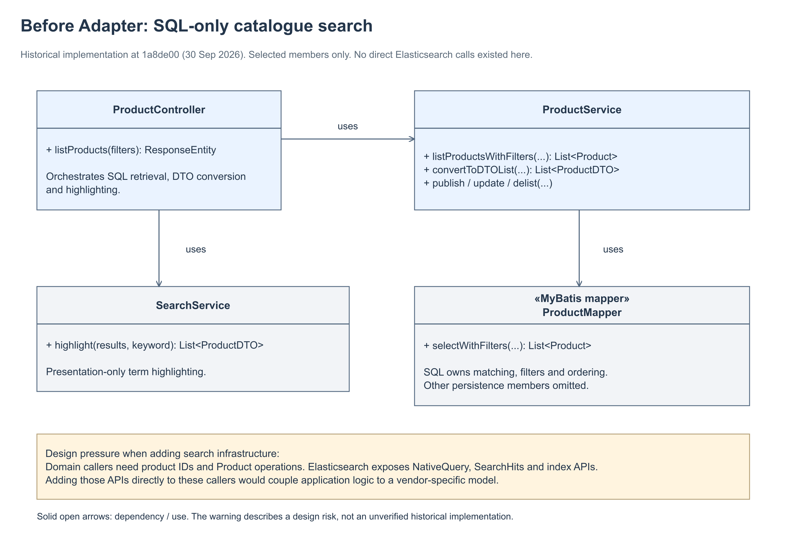
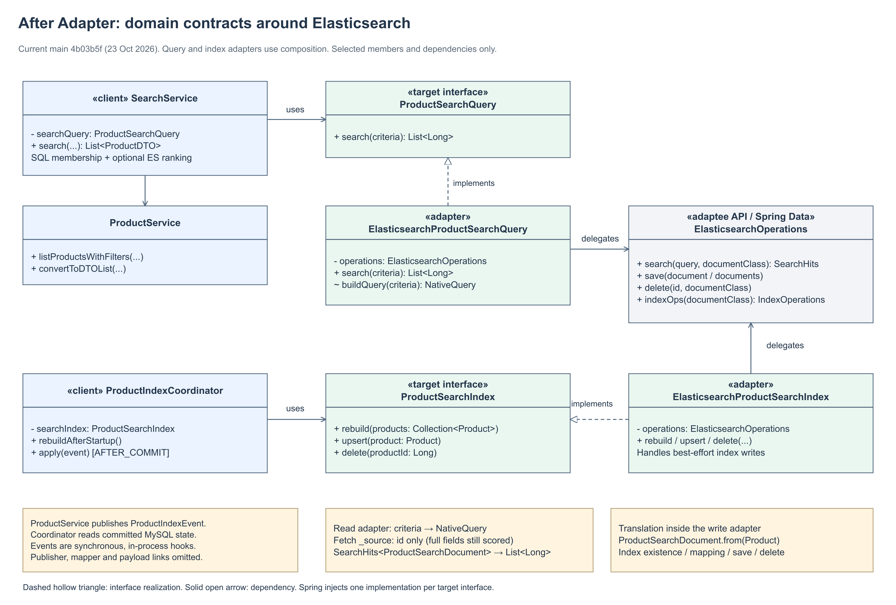
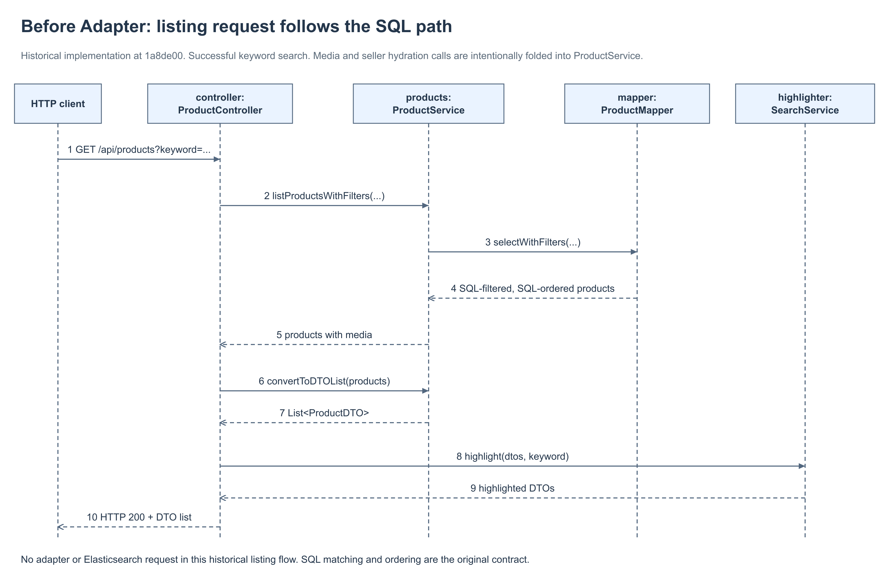
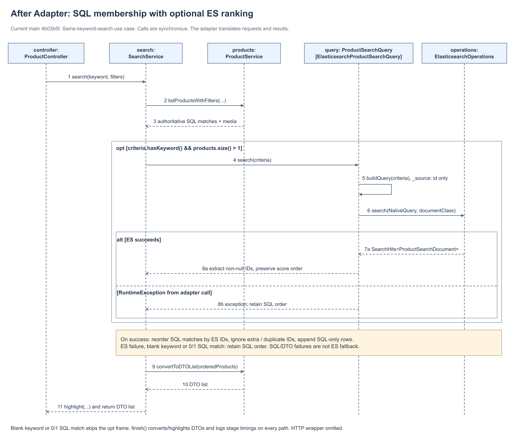

# Adapting Elasticsearch to catalogue operations — Adapter

**Owner:** M2 YUAN CHENG

**Scope:** WP2 listing search and search-index synchronisation

**Code baseline:** `main` at [`4b03b5f`](https://github.com/NUS-SE-34FT-GROUP4/c2cTradePlatform/commit/4b03b5f81cdb5013b01b315340e576b153283118), checked 23 October 2026, including merged search-overhead PR #146.

**Deliverables:** this explanation and four UML figures, each with editable draw.io source and a PNG preview.

## 1. The design problem

The catalogue originally searched through MySQL. `ProductController.listProducts()` called
`ProductService.listProductsWithFilters()`, converted the returned products into DTOs, and
called `SearchService.highlight()`. The mapper's SQL owned matching, filters and ordering.

Adding Elasticsearch introduces a different interface and data model. Application code
needs operations such as “rank products matching these filters”, “index this product” and
“remove this product ID”. Spring Data Elasticsearch instead exposes `NativeQuery`,
`SearchHits<ProductSearchDocument>`, document mappings and index-management APIs.

Putting these details directly into the controller or catalogue services would couple
business orchestration to Elasticsearch. Query-building changes, result conversion and
index setup would then leak into application logic and its tests. Index failures must also
remain separate from successful MySQL writes.

**Historical accuracy:** the before figures use the actual pre-adapter implementation at
[`1a8de00`](https://github.com/NUS-SE-34FT-GROUP4/c2cTradePlatform/commit/1a8de00bb40b65d381f76560235d5a0a913f5adc).
Elasticsearch was already present in deployment configuration, but this listing flow was
SQL-only. The repository does **not** establish an earlier version where these services
directly called Elasticsearch. Direct coupling is the design risk being avoided, not an
invented past implementation.

## 2. The chosen pattern and why it fits

We use **object Adapter** on both the read and write sides. Each concrete adapter implements
an application-owned target interface and holds an `ElasticsearchOperations` dependency.
It translates application arguments into Elasticsearch calls and translates the results
back. It uses composition, rather than inheriting from the Elasticsearch client.

| Pattern role | Query side | Index-write side |
|---|---|---|
| Client | `SearchService` | `ProductIndexCoordinator` |
| Target interface | `ProductSearchQuery.search(criteria): List<Long>` | `ProductSearchIndex.rebuild(products)`, `upsert(product)`, `delete(id)` |
| Concrete adapter | `ElasticsearchProductSearchQuery` | `ElasticsearchProductSearchIndex` |
| Adaptee API | `ElasticsearchOperations.search(...)` | `ElasticsearchOperations.save/delete/indexOps(...)` and `IndexOperations` |
| Translation | `ProductSearchCriteria` → `NativeQuery`; `SearchHits` → ordered product IDs | `Product` → `ProductSearchDocument`; product operations → mapping, save and delete operations |

Spring injects the implementations through constructor dependencies. There is currently
**one concrete implementation per target interface**, not a runtime engine selector.

### Why Adapter instead of another pattern?

- **Direct SDK calls or a static helper:** these could reduce repeated code, but callers
  would still know Elasticsearch types unless the helper also established a domain boundary.
  Our target interfaces explicitly keep those types out of the callers' contracts.
- **Strategy:** strategies primarily provide alternative algorithms under the same
  contract. Here the central task is translating an existing infrastructure API and its
  data types into catalogue operations. The interfaces permit future alternatives, but
  the implemented responsibility is adaptation, not runtime algorithm selection.
- **Facade:** a facade simplifies a subsystem. These classes do simplify Elasticsearch,
  but also implement target contracts and translate incompatible request/result models,
  which is the more specific Adapter role.
- **Observer / transaction events:** `ProductIndexEvent` and its after-commit listener
  determine **when** indexing happens. The Adapter determines **how** a catalogue indexing
  operation maps to Elasticsearch. They solve different parts of the design.

## 3. Code correspondence

Paths below are relative to the repository root. Method names refer to the stated main
snapshot, not to pending feature branches.

| Code | Responsibility and evidence |
|---|---|
| [`controller/ProductController.java`](../../src/main/java/sg/edu/nus/iss/c2csectrade/controller/ProductController.java), `listProducts()` | Delegates catalogue search to `SearchService.search()`. Does not construct an ES query. |
| [`service/SearchService.java`](../../src/main/java/sg/edu/nus/iss/c2csectrade/service/SearchService.java), constructor and `search()` | Depends on `ProductSearchQuery`, retrieves authoritative SQL matches first, applies ES ID ordering, handles query exceptions, then converts and highlights DTOs. |
| [`service/search/ProductSearchCriteria.java`](../../src/main/java/sg/edu/nus/iss/c2csectrade/service/search/ProductSearchCriteria.java) | Application record for keyword, price bounds, condition, location and categories. Normalises blank strings and parses categories. Contains no ES query type. |
| [`ProductSearchQuery.java`](../../src/main/java/sg/edu/nus/iss/c2csectrade/service/search/ProductSearchQuery.java) | Read-side target interface returning `List<Long>`, not `SearchHits`. |
| [`ElasticsearchProductSearchQuery.java`](../../src/main/java/sg/edu/nus/iss/c2csectrade/service/search/ElasticsearchProductSearchQuery.java), `buildQuery()` / `search()` | Builds boosted `multi_match` (`name^4`, `category^2`, `description`) and catalogue filters; requests at most 1,000 hits with `_source` limited to `id`; extracts non-null IDs in score order. Filtering and scoring still use the full indexed fields. |
| [`ProductSearchIndex.java`](../../src/main/java/sg/edu/nus/iss/c2csectrade/service/search/ProductSearchIndex.java) | Write-side target using `Product`, collections and IDs. No ES mapping or index type escapes through this interface. |
| [`ElasticsearchProductSearchIndex.java`](../../src/main/java/sg/edu/nus/iss/c2csectrade/service/search/ElasticsearchProductSearchIndex.java) | Ensures index mappings, maps and saves searchable products, deletes documents and rebuilds the index. Logs ES runtime failures on the supported write paths. |
| [`ProductSearchDocument.java`](../../src/main/java/sg/edu/nus/iss/c2csectrade/service/search/ProductSearchDocument.java), `from()` | ES projection for index `products`. Converts seller ID, price to `Double`, available stock and timestamps, alongside searchable fields. MySQL remains canonical. |
| [`ProductIndexCoordinator.java`](../../src/main/java/sg/edu/nus/iss/c2csectrade/service/search/ProductIndexCoordinator.java), `apply()` / `rebuildAfterStartup()` | Calls the target after transaction commit or on application readiness. Re-reads the committed row before deciding upsert versus delete. |
| [`ProductService.java`](../../src/main/java/sg/edu/nus/iss/c2csectrade/service/ProductService.java), `publish()` / `update()` / `delist()` | Publishes `ProductIndexEvent` after changing MySQL within its transaction; does not call Elasticsearch directly. |

### Query behaviour in the solution

1. `SearchService` obtains SQL matches through `ProductService` and the mapper. This query
   remains authoritative even when Elasticsearch is healthy.
2. For a nonblank keyword with at least two SQL matches, it calls
   `ProductSearchQuery.search(criteria)`. Zero or one SQL match needs no ranking and skips
   ES. The concrete adapter builds the ES query and translates the hits into IDs.
3. The service reorders only the SQL matches. Extra or duplicate ES IDs cannot add products;
   SQL rows missing from ES are appended in their original SQL order.
4. If the adapter throws a `RuntimeException`, the service retains the SQL order. Blank
   keywords also bypass ES. All paths reach `finish()`, which converts DTOs, applies
   highlighting and logs SQL/media, ES, DTO/highlighting and total elapsed time without
   logging the query text. The zero/one-result shortcut preserves this processing.
5. MySQL failures and DTO-conversion failures are outside the ES fallback boundary and
   are not disguised as successful degradation.

This is **SQL-authoritative search with optional ES ranking**, not “ES first and MySQL only
when ES fails”. `ProductService.listProductsByIdsInOrder()` exists, but the current
`SearchService.search()` does not use it.

### Write behaviour in the solution

For a listing update, the service changes MySQL and publishes `ProductIndexEvent` inside
the transaction. After commit, `ProductIndexCoordinator.apply()` re-reads the product.
It calls `ProductSearchIndex.upsert()` for an active product with available stock, or
`delete()` for a missing/unsearchable product. The concrete adapter translates the product
into a search document and delegates to Elasticsearch. On startup, the coordinator calls
`rebuild()` for the active catalogue.

The after-commit hook is synchronous and in-process. It is **not** a queue, an asynchronous
worker or an atomic transaction spanning MySQL and Elasticsearch.

## 4. Before and after figures

The before pair shows the real SQL-only implementation. The after class diagram includes
both adapters. The after sequence uses the same keyword-listing scenario as the before
sequence, with optional ranking and failure handling. It does not attempt to show the
separate write/startup scenarios in the same interaction.

| Figure | Editable source | PNG |
|---|---|---|
| 1. Before: class diagram | [01-before-class.drawio](diagrams/m2-adapter/01-before-class.drawio) | [PNG](diagrams/m2-adapter/01-before-class.png) |
| 2. After: class diagram | [02-after-class.drawio](diagrams/m2-adapter/02-after-class.drawio) | [PNG](diagrams/m2-adapter/02-after-class.png) |
| 3. Before: sequence diagram | [03-before-sequence.drawio](diagrams/m2-adapter/03-before-sequence.drawio) | [PNG](diagrams/m2-adapter/03-before-sequence.png) |
| 4. After: sequence diagram | [04-after-sequence.drawio](diagrams/m2-adapter/04-after-sequence.drawio) | [PNG](diagrams/m2-adapter/04-after-sequence.png) |

Notation: a dashed hollow triangle denotes interface realization. Solid open arrows in
class diagrams denote directed use relationships. Sequence calls use filled arrowheads;
returns use dashed open arrowheads. Only relevant members are shown; `...` abbreviates
parameters or related methods. Helper payloads and secondary hydration calls are omitted
where explicitly noted. Native draw.io objects remain editable, including text and edges.

## 5. Benefits, trade-offs and limits

- **Isolated translation:** callers use product-oriented interfaces. SDK query-building,
  hit conversion and index-management changes stay inside the adapter layer.
- **Independent tests:** `SearchServiceTest` mocks `ProductSearchQuery`; coordinator tests
  mock `ProductSearchIndex`; adapter tests mock `ElasticsearchOperations`.
- **A replacement still requires work:** another engine needs new implementations,
  configuration, indexing and parity tests. There is no implemented SQL adapter and no
  promise of identical ranking across engines.
- **Consistency has limits:** MySQL owns result membership, while a stale/missing index can
  still change ranking quality. Failed index events have no durable retry or outbox.
  Startup rebuild deletes and recreates the index, so it is not a zero-downtime reindex.
- **No automatic performance claim:** SQL and ES remain sequential when ranking is needed.
  The ES query window is 1,000, while SQL-only matches are appended; the HTTP API is not
  paginated. Keyword requests with at least two SQL matches retry ES after an outage,
  with no circuit breaker in this code.
- **Merged optimisation boundary:** PR #146 skips ES for zero/one SQL match, limits ES
  response `_source` to `id`, and records stage timings. These changes reduce unnecessary
  work and expose where time is spent; this write-up does not claim a measured P95 gain.
- **Pattern versus resilience policy:** Adapter isolates the vendor API. SQL fallback,
  membership reconciliation and after-commit coordination are additional application
  policies, not guarantees automatically provided by the pattern.

## 6. Existing tests and traceability

These are source-level evidence, inspected at the stated main snapshot. No new test,
performance benchmark, deployment or fault-injection run was executed for this write-up.

| Test file | Relevant assertions |
|---|---|
| `service/search/ElasticsearchProductSearchQueryTest.java` | Preserves ES hit order as IDs, builds keyword boosts and filters, enforces the result window and ID-only source filter, rejects missing keywords. |
| `service/search/ElasticsearchProductSearchIndexTest.java` | Creates mapping before save, rebuild removes stale index, deletes documents, avoids saving inactive listings, tolerates ES write outage. |
| `service/search/ProductSearchDocumentTest.java` | Maps the canonical product into the search projection. |
| `service/search/ProductIndexCoordinatorTest.java` | Startup rebuild, committed-product upsert, deletion of missing/delisted products and startup failure tolerance. |
| `service/SearchServiceTest.java` | SQL membership, ES ordering/fallback/retry, blank keyword and zero/one-match bypass, missing/extra/duplicate hits, result-window preservation, SQL/DTO failure propagation, highlighting and stage timing output. |
| `integration/SearchParityIT.java` | Real ES outage/recovery scenario and stale/missing documents against MySQL-backed results. Reading this test is not a claim that it was rerun for these diagrams. |

Implementation milestones: [`1993500`](https://github.com/NUS-SE-34FT-GROUP4/c2cTradePlatform/commit/1993500)
introduced index synchronisation; [`a07aa75`](https://github.com/NUS-SE-34FT-GROUP4/c2cTradePlatform/commit/a07aa75)
introduced ranked query integration. The after figures describe the later main baseline,
including subsequent membership-parity fixes and PR #146, rather than attributing every improvement
to the original Adapter change.

## 7. Short presentation explanation

> Our original catalogue search used SQL, while SearchService only added highlighting.
> Adding Elasticsearch introduced a different query and document API. We used two object
> adapters: one converts catalogue criteria into Elasticsearch queries and returns product
> IDs, and one converts product changes into index operations. The application depends on
> ProductSearchQuery and ProductSearchIndex, rather than Elasticsearch types. MySQL still
> determines which products appear, and Elasticsearch only helps order them. This isolates
> infrastructure changes and makes the callers easier to test. It does not eliminate
> indexing lag or guarantee faster searches; those remain separate engineering concerns.
