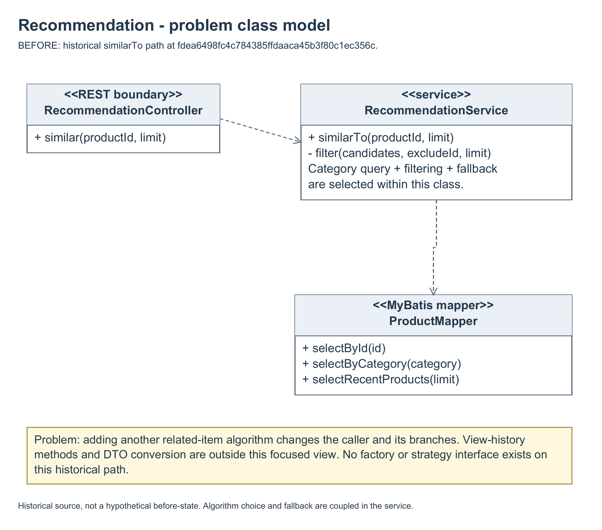
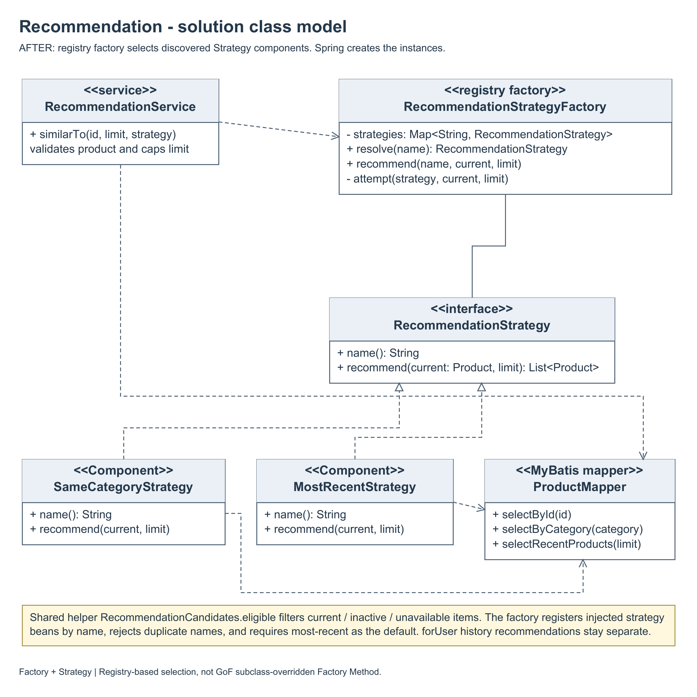
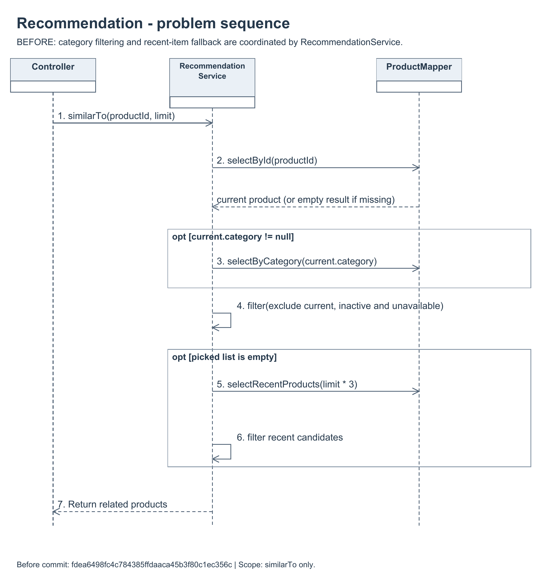
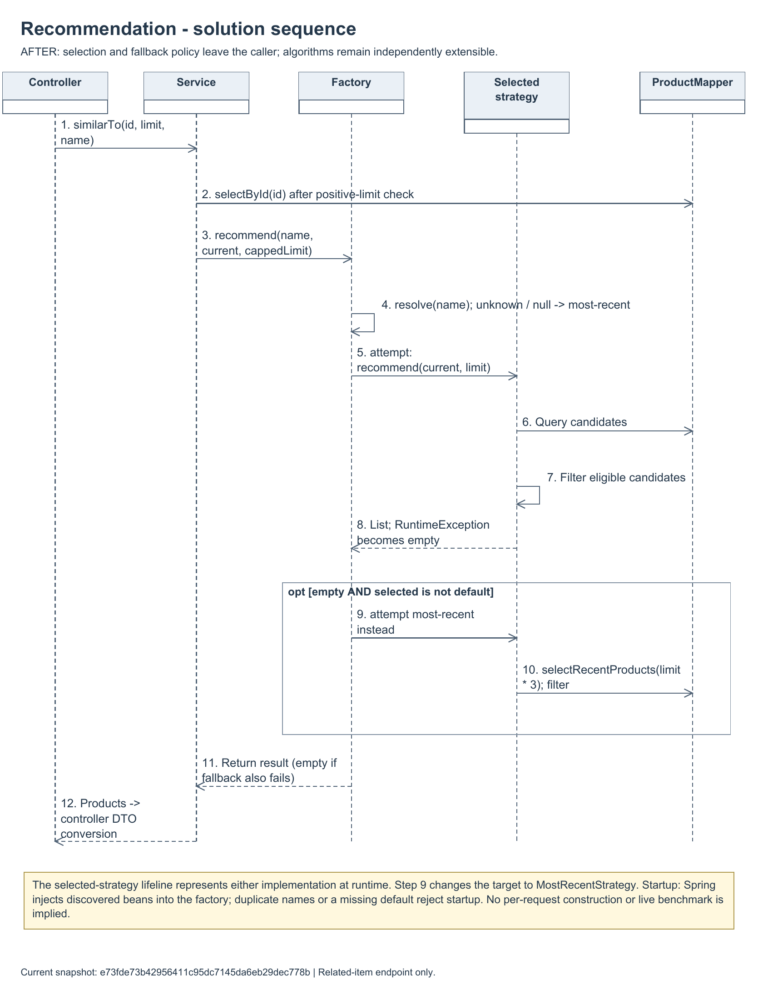

# Recommendation factory models before and after

Author: CUI ZIJIAN (KabiKabiKabigon). Prepared 28 October 2026 for final report section 3.5.5 and issue #100.

The [design problem and decision](../../M5-cui-zijian.md) explains the selected registry-based Factory combined with Strategy. Spring creates strategy instances; the factory resolves a registered instance by name. This is not the subclass-overridden GoF Factory Method pattern.

- Before snapshot: `fdea6498fc4c784385ffdaaca45b3f80c1ec356c`, before the recommendation factory change.
- After snapshot: `e73fde73b42956411c95dc7145da6eb29dec778b`.

| Model | PNG | Editable source |
|---|---|---|
| Problem class model | [PNG](01-before-class.png) | [draw.io](01-before-class.drawio) |
| Solution class model | [PNG](02-after-class.png) | [draw.io](02-after-class.drawio) |
| Problem sequence | [PNG](03-before-sequence.png) | [draw.io](03-before-sequence.drawio) |
| Solution sequence | [PNG](04-after-sequence.png) | [draw.io](04-after-sequence.drawio) |

The before models show algorithm selection, category logic and recent-item fallback inside the caller. The after models show the discovered strategy registry, shared eligibility checks, name resolution and fallback behaviour. Models refer to inspected code at the stated snapshots rather than a proposed future design. File hashes for both M5 diagram sets are retained in [the UML manifest](../m5-uml-manifest.json).

