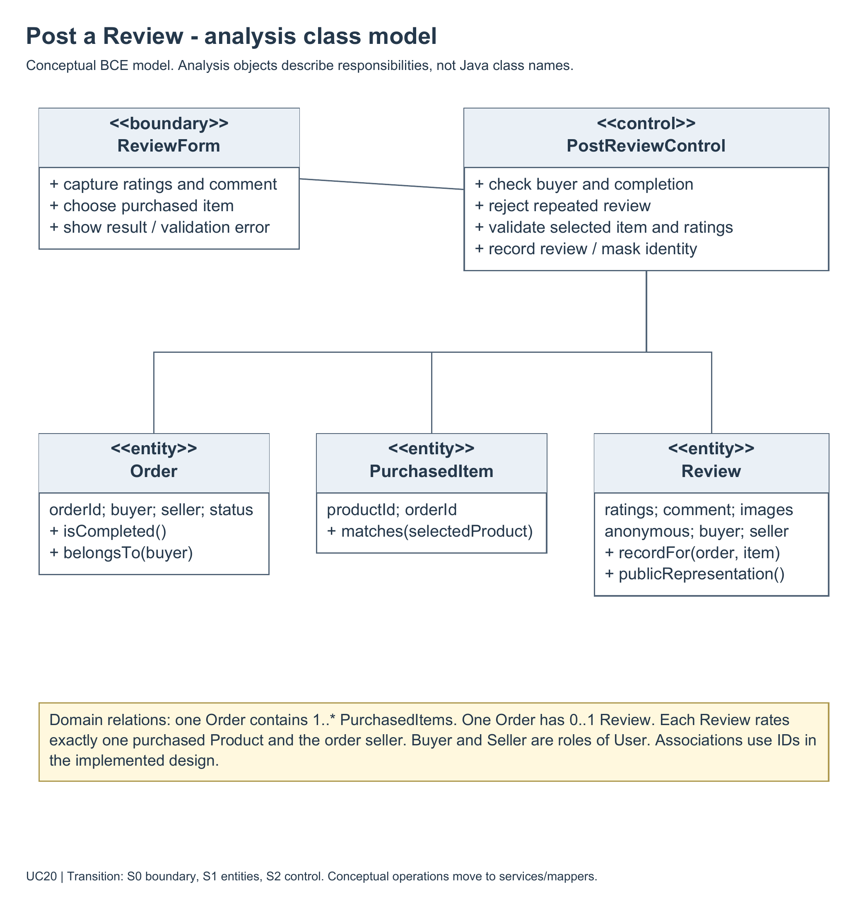
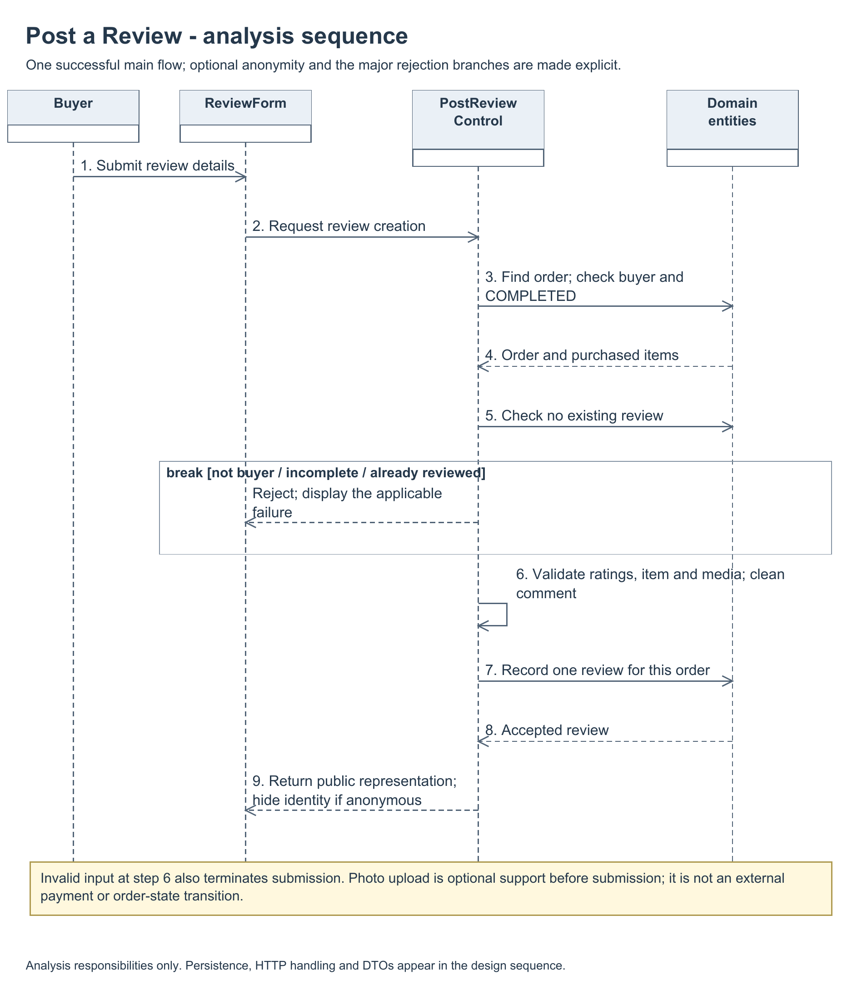
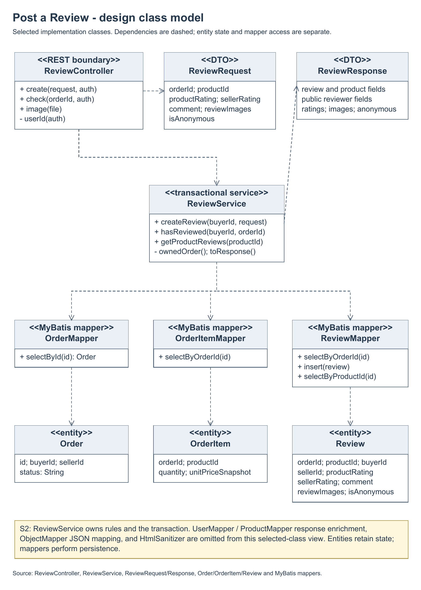
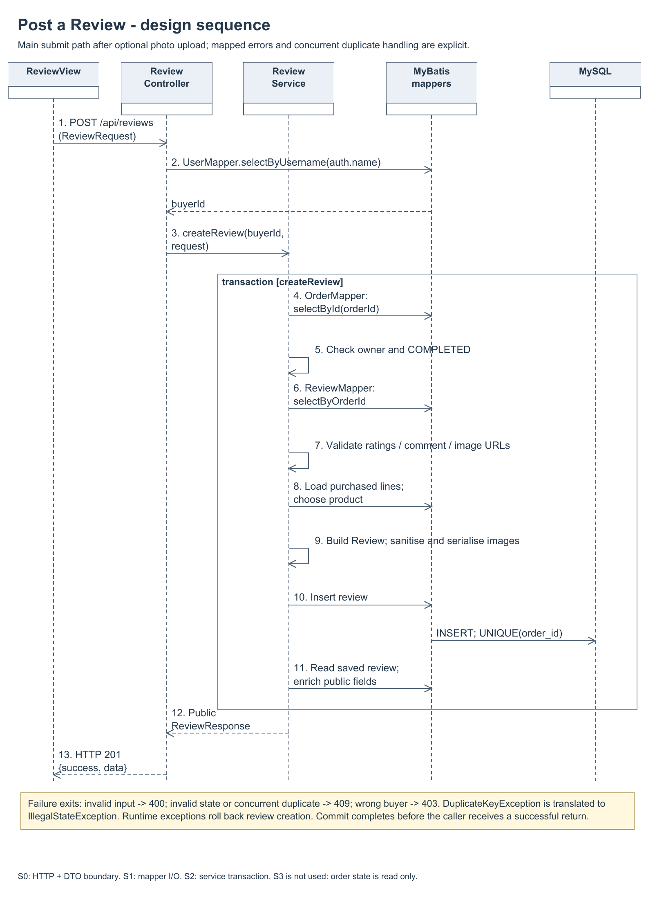

# Post a review analysis and design models

Author: CUI ZIJIAN (KabiKabiKabigon). Prepared 28 October 2026 for final report section 3.4.5 and issue #100.

These models describe implementation revision `e73fde73b42956411c95dc7145da6eb29dec778b`. Each exported image has an editable native draw.io file beside it. The files are the same models already placed in the shared report.

| Model | PNG | Editable source |
|---|---|---|
| Analysis class | [PNG](01-analysis-class.png) | [draw.io](01-analysis-class.drawio) |
| Analysis sequence | [PNG](02-analysis-sequence.png) | [draw.io](02-analysis-sequence.drawio) |
| Design class | [PNG](03-design-class.png) | [draw.io](03-design-class.drawio) |
| Design sequence | [PNG](04-design-sequence.png) | [draw.io](04-design-sequence.drawio) |

## Transition strategy trace

- S0: the review boundary becomes the REST controller and request/response DTOs.
- S1: entities retain data; MyBatis mappers own persistence operations.
- S2: ReviewService owns validation and the transaction boundary.
- S3 is not applied to this use case: the completed order status is checked, not transitioned by posting a review.

The sequence model covers validation and duplicate-review handling. The database's unique order constraint protects concurrent submissions in addition to the service precheck. Review image upload and the database transaction are separate operations; this model does not claim an atomic object-storage/database transaction.

Code trace: `ReviewController`, `ReviewService`, `ReviewMapper`, `OrderMapper`, `OrderItemMapper`, `ReviewRequest` and `ReviewResponse`, plus the unique review-order constraint in `init.sql`. This model is design documentation, not additional runtime acceptance evidence.

